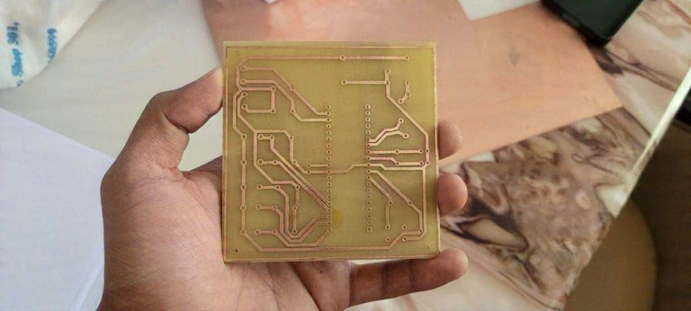
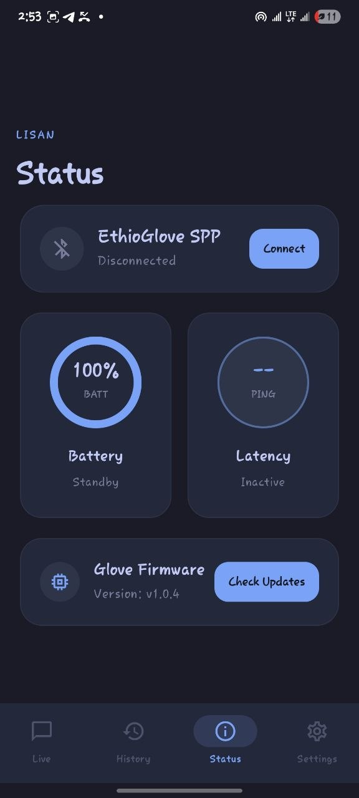
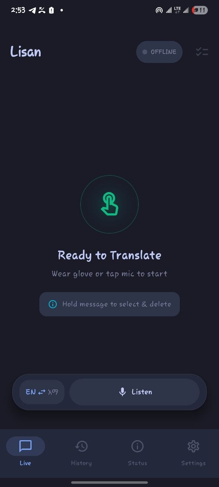

# 🖐️ Lisan: Smart Glove for Ethiopian Sign Language (ESL)

[-blue.svg)]()
[]()
[]()
[]()
[]()

**Lisan (ሊሳን)** is an assistive cyber-physical system designed to bridge the communication gap for the Deaf and hard-of-hearing community in Ethiopia. The system captures kinematic hand gestures performed in **Ethiopian Sign Language (ESL)** using a sensorized smart glove, digitizes and serializes the 11-channel motion telemetry over Bluetooth SPP, and translates the gesture stream into real-time Amharic text and spoken audio via an AI-driven Android application.

This project is developed as the **Embedded System Group 6 Project**.

---

## 📸 System Showcase

### 1. Fabricated Custom PCB
The custom printed circuit board (PCB) has been designed, verified, and **physically fabricated and etched**. It houses the ATmega32 MCU socket, crystal oscillator, power regulation, Bluetooth differential routing, and sensor interfaces.

<div align="center">
  
  <p><em>Figure 1: Custom etched and fabricated PCB for the Lisan Smart Glove (Embedded System Group 6).</em></p>
</div>

### 2. Companion Mobile Application (Jetpack Compose)
The Android companion application provides real-time gesture telemetry, bidirectional translation, and voice synthesis.

<div align="center">
  <table>
    <tr>
      <td align="center">
        
        <br />
        <strong>Status & Diagnostics Dashboard</strong>
        <br />
        <em>Live Bluetooth SPP status, battery percentage, ping latency monitor, and firmware version tracker.</em>
      </td>
      <td align="center">
        
        <br />
        <strong>Live Bilingual Translation Stream</strong>
        <br />
        <em>Dual-mode gesture-to-speech output, Amharic-English toggles, and voice input with echo cancellation.</em>
      </td>
    </tr>
  </table>
</div>

---

## 📊 Project Status & Engineering Readiness

| Subsystem / Component | Status | Details |
| :--- | :---: | :--- |
| **Custom PCB Fabrication** | ✅ **Completed** | Schematics finalized in EasyEDA; physical copper PCB etched and verified. |
| **Bare-Metal C Firmware** | ✅ **Completed** | Converted from Arduino to low-latency register-level C (ADC, TWI/I2C, MPU-6050, UART); verified compilation (`make all`). |
| **AI Gesture Recognition** | ✅ **Completed** | Deep Neural Network, Random Forest & SVM trained on 8-feature glove dataset; 99.5% accuracy; standalone models in `model/`. |
| **On-Device TFLite Inference**| ✅ **Completed** | Embedded normalization TFLite model running live in Android app with gesture stabilization & debouncing. |
| **Android Companion App** | ✅ **Completed** | Jetpack Compose UI, Bluetooth SPP manager, Amharic TTS (`am-ET`) with acoustic echo cancellation. |
| **Flex Sensors (5x Fingers)** | ⏳ **Pending** | 5x bidirectional bend sensors (thumb to pinky) to be acquired/fabricated. |
| **PCB Component Soldering** | ⏳ **Pending** | Populating and soldering the ATmega32 socket, passives, regulator, charger, and modules onto the etched board. |
| **Glove Mechanical Assembly** | ⏳ **Pending** | Attaching sensors to glove fingers and mounting the 3D-printed enclosure (`Final-Desgin.glb`). |

> 📄 **Detailed Technical Report**: For complete electrical schematics, driver register configurations, and architectural gap analysis, see [`Embedded_System_Group_6_Project_Report.pdf`](Embedded_System_Group_6_Project_Report.pdf).  
> 🔄 **Arduino to Bare-Metal Guide**: See [`firmware/ARDUINO_TO_BAREMETAL.md`](firmware/ARDUINO_TO_BAREMETAL.md) for direct register comparisons with Arduino HAL.  
> 🧠 **Standalone Models & Training**: See [`model/README.md`](model/README.md) for pre-trained weights, training script, and Python usage.

---

## 🤖 Gesture Recognition Models (`model/`)

For researchers and developers wanting the standalone gesture recognition models without compiling the mobile app or firmware, the repository includes a complete machine learning suite in `model/`:

- **Input Features (8-D Vector)**:
  - `THUMB, INDEX, MIDDLE, RING, LITTLE`: 10-bit flex sensor ADC readings (0–1023).
  - `G1, G2, G3`: MPU6050 3-axis acceleration vector from register `0x3B` (`ACCEL_XOUT_H`..`Z`).
- **Outputs**: 26 gesture classes with confidence probabilities.
- **Model Formats Provided**:
  - `glove_model.tflite` (18 KB): Optimized on-device model with **embedded Keras Normalization layer** (raw telemetry input, no manual client-side scaling needed).
  - `glove_model.keras` & `glove_model.h5`: Full deep neural network weights (Test Accuracy: **99.55%**).
  - `glove_rf_model.joblib`: Random Forest Classifier (Test Accuracy: **99.80%**).
  - `glove_svm_model.joblib`: Support Vector Machine Classifier (Test Accuracy: **98.70%**).
  - `dataset.csv`: 8-feature glove sensor dataset with 26 labeled gesture classes.
  - `train_models.py`: End-to-end reproducible training and export pipeline.
  - `labels.txt` & `labels.json`: Class index mapping (1 = Victory, 2 = Come here, 3 = Okay, 4 = Stop, etc.).

---

## 📂 Repository Architecture

The project is structured into four primary domains:

```
lisan/
├── hardware/                  # Physical & Electrical Design
│   ├── PCB/                   # PCB layout PDFs, schematics images, and Gerber metadata
│   ├── mechanical/            # 3D models (Final-Desgin.glb) for glove housing
│   └── SCH_smartgloveredesigned_2026-09-14.json  # EasyEDA schematic design
│
├── firmware/                  # Embedded Systems (Bare-Metal C for ATmega32)
│   ├── inc/                   # Header files (adc.h, i2c.h, mpu6050.h, uart.h)
│   ├── src/                   # Driver implementations
│   │   ├── adc.c              # 10-bit successive approximation ADC driver (PA0-PA4)
│   │   ├── i2c.c              # Hardware TWI/I2C master driver (100kHz on PC0/PC1)
│   │   ├── mpu6050.c          # 6-DOF IMU initialization & burst register read (0x3B)
│   │   ├── uart.c             # 9600-baud USART serial transmitter (PD0/PD1)
│   │   └── main.c             # 50ms periodic sampling and 8-feature telemetry stream loop
│   ├── ARDUINO_TO_BAREMETAL.md# Comprehensive comparison with reference Arduino code
│   └── Makefile               # AVR build automation script (avr-gcc / avrdude)
│
├── model/                     # Machine Learning & AI Gesture Recognition Models
│   ├── glove_model.tflite     # Standalone TFLite model with embedded normalization
│   ├── glove_model.keras      # Keras deep neural network model
│   ├── glove_model.h5         # HDF5 model weights
│   ├── glove_rf_model.joblib  # Scikit-learn Random Forest model
│   ├── glove_svm_model.joblib # Scikit-learn SVM model
│   ├── dataset.csv            # 8-feature glove sensor dataset
│   ├── labels.txt & labels.json # 26 gesture class labels
│   ├── train_models.py        # Python training and export script
│   └── README.md              # Model documentation and quickstart code
│
├── mobile-app/                # Android Companion Application
│   ├── app/src/main/assets/   # Assets (glove_model.tflite, labels.txt)
│   ├── app/src/main/java/com/example/
│   │   ├── managers/          # GloveGestureClassifier.kt, GloveBluetoothManager.kt, SpeechManager.kt
│   │   ├── viewmodel/         # MainViewModel.kt (reactive TFLite inference & StateFlows)
│   │   ├── ui/                # Jetpack Compose UI screens, themes, and bilingual translations
│   │   └── data/              # Room SQLite database (AppDatabase.kt)
│   └── build.gradle.kts       # Android build config (TensorFlow Lite, Compose, Room)
│
└── Embedded_System_Group_6_Project_Report.pdf # Comprehensive technical engineering report
```

---

## ⚡ Hardware Pinout & Interconnect Specifications

The central controller is the **ATmega32-16PU** (8-bit AVR RISC clocked at 16 MHz):

| ATmega32 Pin | Function / Signal | Connected Target | Circuit Configuration |
| :--- | :--- | :--- | :--- |
| **PA0 – PA4** | ADC0 – ADC4 (Analog Input) | Flex Sensors 1 to 5 (Fingers) | Voltage divider (10kΩ pull-down resistors to GND) |
| **PC0, PC1** | SCL, SDA (Hardware TWI/I2C) | MPU-6050 6-DOF IMU | Dual 4.7kΩ pull-up resistors to VCC rail |
| **PD0, PD1** | RXD, TXD (UART Serial) | HC-05 Bluetooth Module | Differential noise-immune trace routing |
| **XTAL1, XTAL2** | System Clock Oscillator | 16 MHz Quartz Crystal | Dual 22pF ceramic load capacitors to GND |
| **RESET** | Active-Low Hardware Reset | Tactile Push Button | 10kΩ pull-up to VCC, 100nF debounce capacitor |
| **Power Rails** | VCC, GND | Mini-360 & IP2326 Charger | Single-cell Li-ion step-down to regulated VCC rail |

---

## 🚀 Step-by-Step Setup & Build Guide

### 1. Compiling and Flashing the Firmware

**Prerequisites**: `avr-gcc`, `avr-libc`, `make`, and optionally `avrdude` for flashing.

1. Navigate to the firmware directory:
   ```bash
   cd firmware
   ```
2. Compile the bare-metal C code into ELF and HEX binaries:
   ```bash
   make clean && make all
   ```
3. Connect your in-system programmer (e.g., USBasp) and flash the ATmega32:
   ```bash
   make flash
   ```

### 2. Running the Mobile App

**Prerequisites**: [Android Studio](https://developer.android.com/studio) (Ladybug or newer).

1. Open Android Studio and choose **Open**, selecting the `mobile-app` directory.
2. Allow Gradle to sync the dependencies (configured in `build.gradle.kts` and `libs.versions.toml`).
3. Connect your Android test device via USB (or start an emulator) and ensure Bluetooth is enabled.
4. Click **Run** to build and deploy the APK.
5. In the app, navigate to the **Status** tab and tap **Connect** to pair with the glove's HC-05 Bluetooth SPP module.

---

## 👥 Project Team

- **Embedded System Group 6 Project**
- Project Mentors & Evaluators
